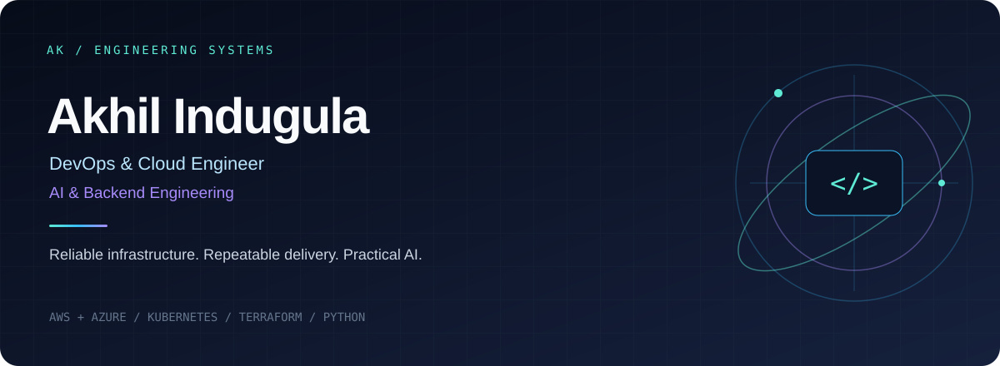
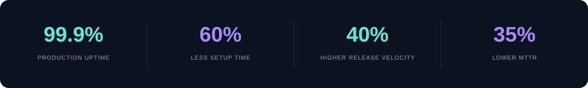

Hyderabad, India

[01 About](#01--about-me) · [02 Focus](#02--engineering-focus) · [03 Stack](#03--tech-stack) · [04 Work](#04--featured-engineering-work) · [05 Connect](#05--lets-build-something-useful)

---

## 01 / About me

I’m a DevOps and Cloud Engineer specializing in AWS, Azure, Kubernetes, and infrastructure automation. I build reliable cloud platforms, repeatable CI/CD pipelines, and Python backend services, with hands-on experience integrating LLMs and agentic AI into application workflows. My work connects infrastructure, observability, and backend engineering to make systems easier to deploy, operate, and scale.

## 02 / Engineering focus

| ☁️ Cloud & platform engineering | ⚙️ Automation & delivery | 🤖 AI & backend systems |
| :--- | :--- | :--- |
| AWS and Azure infrastructure | Terraform and configuration automation | Python APIs with FastAPI and Flask |
| Kubernetes workloads on EKS / AKS | Jenkins and Azure DevOps pipelines | LLM and LangChain integrations |
| Observability and incident response | Repeatable builds and deployments | Kafka and event-driven services |

### Impact from previous engineering work

Selected outcomes reported in my resume; these are historical results, not live service metrics.

## 03 / Tech stack

### Cloud platforms

### Containers & infrastructure automation

### CI/CD, source control & builds

### Languages, backend & AI

### Databases & streaming

### Monitoring & observability

### Systems, networking & security

**Architecture & practices:** Microservices · Distributed systems · Event-driven architecture · Infrastructure as Code · SQL / NoSQL data modeling · Root-cause analysis · Least-privilege access

## 04 / Featured engineering work

Selected areas of hands-on experience:

| Area | What I build and operate | Core tools |
| :--- | :--- | :--- |
| **Cloud infrastructure automation** | Repeatable environments, networking, access controls, and infrastructure provisioning | AWS, Azure, Terraform, CloudFormation |
| **Containerized application delivery** | Scalable workloads, rolling updates, deployment pipelines, and health monitoring | Kubernetes, EKS, AKS, Docker, Helm, Jenkins |
| **AI-enabled backend services** | REST APIs, inference endpoints, and LLM-powered workflows | Python, FastAPI, Flask, OpenAI, LangChain |
| **Event-driven data services** | Streaming pipelines and SQL / NoSQL data models for downstream applications | Apache Kafka, MySQL, MongoDB |
| **Production reliability** | Dashboards, alert investigation, root-cause analysis, and operational runbooks | Grafana, CloudWatch, Sumo Logic, AWX |

## 05 / Let's build something useful

Interested in collaborating on **cloud automation, Kubernetes platforms, CI/CD, observability, or AI-enabled backend services**? Let's connect and turn a practical engineering problem into a reliable solution.

---

`BUILD → AUTOMATE → OBSERVE → IMPROVE`

